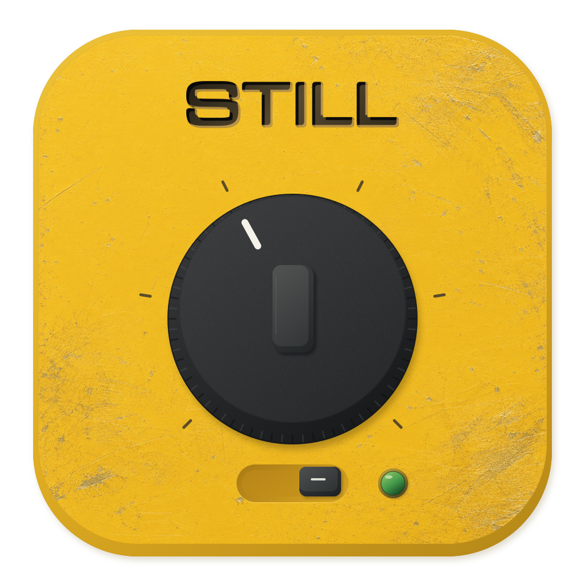

# STILL



**合上屏幕，继续运行。**

STILL 是一个原生 macOS 菜单栏应用，用机械旋钮设定时长、拨杆开启合盖运行。黄色磨损金属机身，红绿拨杆色窗与独立状态灯，深石墨色说明面板。

版本 **1.9.4（build 22）** · macOS 13+ · Apple Silicon / Intel · GPL-3.0-only

## 安装与使用

从仓库的 Releases 下载 DMG 或 ZIP，将 `STILL.app` 拖入「应用程序」。

1. 点击菜单栏图标，转动旋钮或点击刻度，选择 30 分钟、1、2、4、8 或 24 小时。
2. 拨到 **RUN**，等绿灯亮起、状态确认后再合盖。首次开启需要 macOS 管理员授权，密码只输入系统弹窗，应用不保存密码。
3. 拨回 **SLEEP** 恢复正常休眠规则。到时或正常退出也会结束保持运行。

右上角设置中可调整「仅接电源时运行」和「登录时启动」。前者默认开启，拔电会恢复休眠；关闭后可使用电池，**不设最低电量限制**。登录启动不会自动开启运行。旋钮也支持方向键和无障碍操作。

红色 O 表示关闭，绿色 I 表示已确认开启；黄色状态灯表示处理中或需要检查，以旁边的状态文字为准。

**保持通风，放入包内或运输前，先结束运行并确认已恢复休眠。**

### 首次打开与升级

当前安装包为 **ad-hoc 本地签名，未经过 Apple 公证**。确认来源可信后，若 macOS 阻止打开，可在「系统设置 → 隐私与安全性」针对 STILL 选择「仍要打开」；公司 Mac 可能需要 IT 允许。无需关闭 Gatekeeper 或 SIP。[Apple 打开说明](https://support.apple.com/102445)

升级前先恢复休眠并退出，再替换 App。只有电源服务版本变化时才需要重新授权；本版继续使用服务 **1.1.0**。随包指南见 [安装说明](Resources/安装说明.txt)。

## 工作原理与边界

STILL 通过管理员授权的后台服务，在有限会话期间设置 `pmset -a disablesleep`。这是系统级休眠设置，会同时影响合盖、闲置及主动休眠。SLEEP 恢复 macOS 的正常规则，不是立即让电脑睡着；外屏、外设或其他应用仍可能保持唤醒。

该参数见 [Apple 电源管理实现](https://github.com/apple-oss-distributions/PowerManagement/blob/main/pmset/pmset.m)，未列入当前 `pmset` 手册，系统升级后应重新验证。普通 `caffeinate` 防闲置休眠断言不能可靠替代合盖控制。

后台独立处理会话到期、应用退出、心跳失联、仅接电模式下拔电、无法读取电池状态及系统报告严重温度异常时的恢复。状态在更改前持久化，恢复后读回核对；不会接管其他工具已经禁用休眠的状态。请避免同时使用多个防休眠工具。

这些保护依赖 macOS、硬件和系统策略，不保证所有机型都能合盖运行，也不能阻止没电、关机或硬件保护。应用无需联网，不含遥测或自动更新。

## 从源码构建

需要 macOS、Xcode Command Line Tools 和 macOS 13+ SDK。使用系统框架，无需第三方包管理器或 Xcode 工程。

```sh
xcode-select --install  # 已安装时跳过
./scripts/build.sh
./scripts/test.sh
./scripts/test-dial.sh
./scripts/test-switch.sh
./scripts/package.sh
```

默认输出双架构 App、DMG、ZIP 与 SHA-256 校验文件至 `dist/`。图标在构建时自动生成；应用与后台服务均执行严格签名验证。

```sh
ARCHS=arm64 ./scripts/build.sh                     # 仅构建 Apple Silicon
APP_VERSION=1.9.5 APP_BUILD=23 ./scripts/build.sh   # 自定义版本
./scripts/export-source.sh                       # 导出干净源码与源码 ZIP
```

测试覆盖客户端编码与解析、后台会话及文件安全逻辑、旋钮拖动几何、拨杆状态和文案。自动化测试不安装服务、不修改系统休眠设置，也不能代替真实硬件验证。

### 在目标 Mac 上验证

在通风的桌面环境保存工作、关闭其他防休眠工具，依次检查：

1. 开启短会话，确认绿色状态和 `pmset -g` 中的 `SleepDisabled 1`。
2. 合盖约一分钟后打开，核对一个持续记录时间的本机任务是否在期间继续运行。
3. 关闭会话，确认 `SleepDisabled 0`，再次合盖确认正常休眠与唤醒。外屏可能触发系统自身的合盖运行模式。
4. 检查到期、退出应用和仅接电模式下拔电的恢复行为。

公开发行前应在目标系统与芯片上实测，并如实记录范围；双架构编译通过不等于所有 Mac 已验证。

## 卸载与应急恢复

先拨回 SLEEP 并确认恢复，再关闭「登录时启动」。在「使用说明与关于 → 故障恢复与卸载」卸载电源服务，最后退出并删除 App。服务由本机已授权用户共用。

需要手动恢复时，在终端执行：

```sh
sudo pmset -a disablesleep 0
pmset -g
```

确认 `SleepDisabled` 为 `0`。此命令也会影响其他防休眠工具的设置；仍异常时请保持通风，重启后检查或联系 IT。

## Developer ID 签名与公证

GitHub 开源不等于 Apple 公证。正式发行可使用自己的 Developer ID Application 证书：

```sh
SIGN_IDENTITY='Developer ID Application: Your Name (TEAMID)' ./scripts/build.sh
xcrun notarytool store-credentials LidKeeper-notary
NOTARY_PROFILE=LidKeeper-notary ./scripts/notarize.sh
```

请通过 Apple 的交互提示将凭据存入钥匙串，不写入仓库或命令历史。公证脚本会上传 App 到 Apple，只有返回 `Accepted` 才附加票据并重新打包。需要 Apple Developer Program 资格及有效证书。[Apple 公证流程](https://developer.apple.com/documentation/security/customizing-the-notarization-workflow)

## 项目结构

```text
Sources/LidKeeper/     菜单栏界面、设置、状态与心跳
Sources/PowerHelper/   管理员服务、会话与电源控制
Resources/            图标、字体、纹理、安装说明
scripts/              构建、测试、打包、公证与源码导出
Tests/                可复现的自动化检查
```

发布流程见 [PUBLISHING.md](PUBLISHING.md)。为兼容已有安装，内部标识继续使用 `com.yeonza.LidKeeper`；界面与分发名称为 STILL。

## 许可与免责声明

Copyright (C) 2026 1anzii

项目原创部分按 **GPL-3.0-only** 开源，允许依许可使用、修改与分发。分发受 GPL 覆盖的修改版本时，应保留版权和许可、注明修改，并按 GPL 提供对应源码。完整条款见 [LICENSE](LICENSE)；字体采用独立的 SIL OFL 1.1，详见 [第三方声明](THIRD_PARTY_NOTICES.md)。

STILL 按现状提供，不作担保，不保证无故障或适合特定用途。请自行评估使用风险；在适用法律允许的范围内，保证与责任限制以 GPL 第 15–17 条为准。
