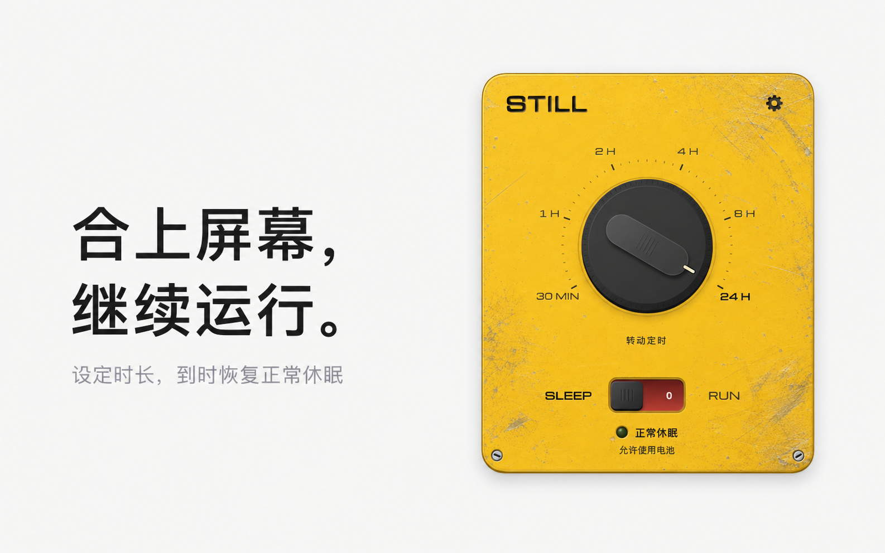

# STILL

**合上屏幕，继续运行。** 为 Agent、下载与其他长任务保持运行。

[下载最新版](https://github.com/1anzii/STILL/releases/latest) · [更新记录](https://github.com/1anzii/STILL/releases) · [使用指南](Resources/安装说明.txt)

macOS 13+ · Apple 芯片 / Intel · 原生菜单栏应用 · 无需联网

## 开始使用

下载 DMG，把 **STILL.app** 拖进「应用程序」。升级前先拨回 SLEEP 并退出旧版。

1. 转动旋钮选时间：30 分钟至 24 小时。
2. 拨到 **RUN**，等绿灯亮起后合盖，让任务继续。
3. 拨回 **SLEEP** 恢复正常休眠规则；到时或正常退出也会结束运行。

首次开启需要管理员授权。当前版本未经过 Apple 公证；确认来源后，可在「系统设置 → 隐私与安全性」选择「仍要打开」。

## 1.10.0 更新

- **合盖自动调暗**：内屏降至约 1.6% 的非零亮度，不主动熄屏，也不调整外接屏幕。
- **开盖恢复原亮度**：保留你后续的手动调整。功能默认开启，可在齿轮菜单关闭。
- **修复电源服务超时**：解决长期运行时的资源泄漏。

从 1.9.4 升级后，请在「使用说明与关于」更新电源服务并完成系统授权；已使用 1.1.1 服务的用户无需再次更新。

保持运行时请保持通风，放入包内前恢复休眠。实际效果因机型和系统而异；降低亮度不等于温度保护。

[开发、构建与验证范围](docs/DEVELOPMENT.md) · [发布指南](PUBLISHING.md) · [第三方声明](THIRD_PARTY_NOTICES.md)

[GPL-3.0-only](LICENSE) · © 2026 1anzii。软件按现状提供，不作担保。
